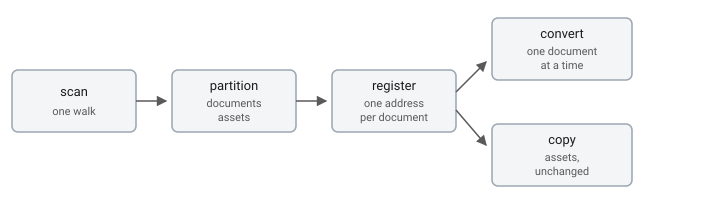

# Addresses and files

A document has two locations, and they are not the same string:

| | Document | Asset |
| --- | --- | --- |
| Address on the site | base path, then the path with `index` folded | base path, then the path |
| File in the output directory | the address with `index.html` | the path, unchanged |

The asymmetry is deliberate. The address carries the base path, because that is
how the site is reached. The file does not, because the output directory is
mounted at the base path rather than containing it.

## The index rule

A document named `index` is the index of its own directory, not a directory of
its own. One rule produces every case:

| Source path | Address | Output file |
| --- | --- | --- |
| `index.md` | `/` | `index.html` |
| `guide/index.md` | `/guide/` | `guide/index.html` |
| `guide/setup.md` | `/guide/setup/` | `guide/setup/index.html` |

Without the rule, `guide/index.md` would publish at `/guide/index/` and the
directory would have no index at all.

## Two path types

The default writes `index.html` inside a directory, so addresses end in a slash.
The alternative writes one file per document, so the file name is visible in the
address:

| Source path | Address (directory) | Address (file) |
| --- | --- | --- |
| `guide/setup.md` | `/guide/setup/` | `/guide/setup.html` |

Either way, the address and the file serving it come from one translation, so
they cannot drift apart.

## The base path

The base path is the prefix the site is mounted at, and it is the only value that
differs between a project site, an organization site and a custom domain:

| Deployment | Base path |
| --- | --- |
| Custom domain | `/` |
| Organization site | `/` |
| Project site | `/<repository>/` |

It must start with a slash and must not carry more than one trailing slash.

## Assets

An asset is not translated. It is copied where it sits, so its address is the
base path followed by its own path, and its output file is its own path:

- `assets/site.css` is published at `/assets/site.css` and written to
  `assets/site.css`
- [assets/site.css](../assets/site.css) is a link to it from this page
-  is an image reference to another

Copying an asset needs no environment, no parse and no tree. It is a separate
pass over the same scan rather than a step in the render loop.

## How a link target is resolved

A target is left alone when it is external, meaning it carries a scheme, or
begins with `//`. Everything else is resolved against the document that wrote
it:

- a target beginning with `/` is relative to the source root
- every other target is relative to the directory holding the document, which is
  what makes a source tree renamable

Both `.` and `..` are resolved. A target that climbs above the source root names
a file that cannot be published, and clamping it would silently publish a link to
something else, so the climb is refused rather than clamped. The one exception is
a root that came from a repository, which can resolve it; see below.

A fragment or query suffix is preserved: `document.md#discovery` becomes the
document's published path with `#discovery` appended.

## Links to the source

Documentation links to things it does not publish: a benchmark result, a workflow
file, a directory of examples. Those targets have no published path, but they are
in the repository the root was read from, so the build points at that instead of
failing.

| Target | Written in | Becomes |
| --- | --- | --- |
| `../../benchmarks/` | `docs/2.0/benchmark-results.md` | `https://github.com/<owner>/<repo>/blob/<commit>/benchmarks` |
| `../../.github/workflows/ci.yml` | `docs/2.0/contributing.md` | `https://github.com/<owner>/<repo>/blob/<commit>/.github/workflows/ci.yml` |

The commit that was read is used rather than a branch name, so a published site
keeps pointing at the tree it was built from.

The same applies to a target that climbs above the site root, which is the case
whenever a root mounted at `/` is shallower than the repository holding it: the
site is only as deep as the mount, so a link written against the repository
legitimately reaches past it.

Three things are never rewritten to the source, and keep the refusal instead:

- a target in a root that is not a git checkout, has no `origin`, or whose remote
  is not a GitHub URL
- a target that still resolves inside the root that was walked, because that is a
  genuinely dead link rather than a link to the source
- a target beginning with `/`, because it is relative to the site root and says
  nothing about the repository
