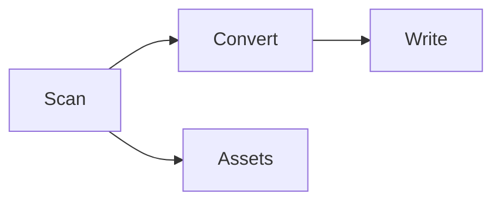

# Theme and templates

A page is rendered by Laminas view in two steps. The document template renders the
body that league/commonmark produced, and the layout wraps that render. Both are
templates, and both can be replaced by the site being built, so a deployment
changes how its pages look without editing this package and without a build flag.

Two words are kept apart throughout this page:

| Word | Means |
| --- | --- |
| Theme | The CSS, JavaScript and images a site ships |
| Template | The `.phtml` file that renders a page or its surrounding shell |

Neither is published as a document. A template is read at render time and its
output is written; the file itself never becomes a page on the site.

## What a build asks for

The renderer asks for a template by name, and these are the names a build
uses:

| Name | Renders |
| --- | --- |
| `commondoc::document` | One document's body |
| `commondoc::layout` | The shell wrapped around every document |
| `commondoc::redirect` | A component's own address, which redirects to its newest version |
| `commondoc::home` | The generated home page of a composed site |
| `commondoc::theme` | The stylesheet the layout renders into a `style` element |

This package registers them in Laminas view's template map and sets
`templates.layout` to `commondoc::layout`, so a site with no theme configured gets
the built-in templates from `templates/default/`.

`commondoc::theme` is CSS, not markup, and it is the one template that is rendered inside a
`style` element rather than as a page. It carries the Asciidoctor-style type scale and colour
tokens, each with a light and a dark value, so the theme toggle recolours the page without a
second request.

## Replacing a template

A site states its templates under the `theme` key, one map per theme name. The map
below is the sibling directory described in
[Where the built-in templates live](#where-the-built-in-templates-live):

```php
return [
    'theme' => [
        'active' => 'webware',
        'themes' => [
            'webware' => [
                'commondoc::document' => __DIR__ . '/../templates/webware/document.phtml',
                'commondoc::layout'   => __DIR__ . '/../templates/webware/layout.phtml',
            ],
        ],
    ],
];
```

`theme.active` names the theme in use. A map is keyed by the exact name the
renderer asks for, so a hit is a lookup and nothing touches the filesystem.

### Fallback is per name

The `default` theme is the fallback for every other theme, resolved one name at a
time rather than as a whole. With `theme.active` set to `webware`, the name
`commondoc::document` renders the first of these that exists:

1. `theme.themes.webware['commondoc::document']`
2. `theme.themes.default['commondoc::document']`
3. the template map entry this package registered

A theme that replaces the layout only, and leaves the document template alone,
gets exactly that. There is no requirement to supply both.

A theme name is a single path segment: it begins with a letter or digit and the rest
is letters, digits, hyphen and underscore. A name containing a slash or a dot, or one
beginning with a hyphen or underscore, is refused when the helper is built.

## Ordering the resolver

The theme is consulted before the template map, which is what lets a site's file
win over the identical name this package registered. That ordering is declared
by the theme package rather than left to the order of a provider list, so a site
does not have to arrange its own `config.php` to get it. It does require that
config is aggregated by a manager that understands provider ordering, such as
`webware/webware-configmanager`, or by one that happens to merge the theme
provider last.

## Assets

Asset names are declared per theme, and the helper turns a relative value into a
path under the theme that defined it:

```php
'theme' => [
    'active' => 'webware',
    'assets' => [
        'default' => [
            'theme.css' => 'css/theme.css',
        ],
        'webware' => [
            'theme.css'  => 'css/theme.css',
            'theme.js'   => 'js/theme.js',
            'bootstrap'  => 'https://cdn.example/bootstrap.min.css',
        ],
    ],
],
```

With `webware` active, measured in a build:

| Call | Returns |
| --- | --- |
| `$this->asset('theme.css')` | `/theme/webware/css/theme.css` |
| `$this->asset('theme.js')` | `/theme/webware/js/theme.js` |
| `$this->asset('bootstrap')` | `https://cdn.example/bootstrap.min.css` |

The `default` theme's values are laid in first and the active theme's over them, so
a name the active theme does not declare is served from `default`, and the path
names `default` because that is the theme that defined it.

A value beginning with `https://`, `http://` or `//` is passed through unchanged.
Anything else is treated as a path inside the theme and gets the `/theme/<theme>/`
prefix.

Names already in Laminas view's own `view_helper_config.asset.resource_map` are the
base of the merged map, so a site that already declares assets there keeps working.

### Publishing the files

The helper returns a path and copies nothing. The asset pass is what writes the file, and
it copies every non-Markdown file beneath a configured root. So the theme directory has to be
a root, or sit inside one, and where that root is mounted decides the published path.

- **A composed site has no root at `/`**: its component sources are mounted at
  `/{component}/v{major}/` and its home page is generated. Mount the theme directory as a root
  of its own at `/theme/`, and the helper's paths already point into it:

  ```php
  'roots' => [
      ['path' => 'theme', 'mount' => '/theme/'],
  ],
  ```

  Measured: `theme/site/css/site.css` is written to `/theme/site/css/site.css`, which is the
  value `$this->asset('site.css')` returns for the `site` theme.

- **A site whose own pages are at `/`** cannot also mount `/theme/`: the two mounts overlap, and
  the build refuses both in the message. The theme directory sits inside that root instead:

  ```php
  'roots' => [
      ['path' => 'docs', 'mount' => '/'],
  ],
  ```

  With the theme at `docs/theme/site/css/site.css`, the asset pass writes
  `/theme/site/css/site.css`, the same path the helper emits.

A theme directory belongs in the repository that publishes the site, not in a documented
repository it composes.

### Base path

The asset helper applies no base path. It returns the value from the map verbatim,
so a site served under a prefix composes the two in its template:

```php
<link rel="stylesheet" href="<?= $this->basePath() . $this->asset('theme.css') ?>">
```

`basePath()` reads `view_helper_config.base_path` and returns it with a trailing
slash removed, so `/commondoc/` and `/commondoc` are the same value. That is also
where the build reads its path space, so the site states the prefix once and both
sides follow it. Measured: setting `base_path` to `/commondoc/` publishes a page at
`/commondoc/getting-started/` and makes `basePath()` return `/commondoc`, which
composes with an asset path without a doubled or missing slash.

## What the templates receive

Both templates are ordinary Laminas view templates, rendered with strict variables
on, so a template that reads a variable it was not given fails the build instead of
rendering an empty string.

`commondoc::document` is rendered with exactly two variables:

| Variable | Type | Contents |
| --- | --- | --- |
| `documentBody` | `string` | The document rendered to HTML, which is what a template echoes |
| `page` | `CommonDoc\View\Page` or `null` | The page this document belongs to, or `null` when the render is not part of a build |

Every field of `Page` is public and readable: `label`, `projectName`, `projectSlug`,
`sourcePath`, `url`, `versionLabel`, `append`, `captureTo`, `children`, `template`
and `terminal`.

`page` is null in a preview render and set in a build, so a template reads it behind
a null check rather than assuming it:

```php
<?php if (null !== $page) : ?>
    <?php $this->headTitle($page->label); ?>
<?php endif ?>
<main class="document">
    <?= $documentBody ?>
</main>
```

`commondoc::layout` receives one variable, `content`, written by the view renderer.
It receives nothing else, and it is rendered for any page the renderer wraps, so it
must not assume a page exists.

`commondoc::redirect` receives one variable:

| Variable | Type | Contents |
| --- | --- | --- |
| `url` | `string` | The address of the newest version, which the page sends the reader to |

It is rendered through the layout, so it inherits the theme and the first paint is in
the theme the reader chose. A replacement template keeps the redirect working by
pushing it through the head helpers: `headScript` for the script that runs before the
first paint, and `headMeta` with `http-equiv="refresh"` for a reader without scripting.
Both escape what they are given, so neither wants a hand-escaped address.

## The default theme

The built-in layout is Bootstrap 5.3 from a pinned CDN version with integrity hashes, with Bootstrap Icons. Resources are queued through the Laminas head helpers (`headMeta`, `headLink`, `headScript`, `headStyle`, `inlineScript`). The layout prepends its own and a replacement page template appends, so order does not depend on which template ran first.

- **Dark and light mode.** Bootstrap styles itself from `data-bs-theme` on the root element. A script in the head sets it from the reader's saved choice, or from the operating system when there is none, before the stylesheet is requested, so the first paint is in the right theme. The toggle in the navbar rewrites the attribute and saves the choice in `localStorage`. Every colour is a CSS variable, so switching never reloads or flashes.
- **Layout.** A navbar with the components menu and the toggle, a sidebar holding the page
  menu, and the document beside it.
- **Admonitions.** The `AdmonitionExtension` writes this markup from a GitHub alert (`> [!WARNING]`, see [Extensions](extensions.md#admonitions)), and the theme styles it. An admonition is an alert with a title:

```html
<div class="admonition admonition-warning alert alert-warning" role="note">
    <p class="admonition-title"><i class="bi bi-exclamation-triangle-fill" aria-hidden="true"></i> Warning</p>
    <p>Body.</p>
</div>
```

  `note` pairs with `alert-info`, `tip` with `alert-success`, `warning` with `alert-warning` and `caution` with `alert-danger`. `important` uses `admonition-important`, which supplies a purple the alert variants lack.

## Code and diagrams

A fenced block with a language is coloured, and a `mermaid` block is drawn as a diagram:

```php
final readonly class Greeting
{
    public function __invoke(string $name): string
    {
        return "Hello, {$name}";
    }
}
```



- **Highlighting** is highlight.js 11, in the browser, with its common set of 36 languages, which includes PHP, JavaScript, JSON, YAML, XML, SQL, Bash, INI and Markdown. A block with no language is left uncoloured, because guessing a language would colour prose. Dockerfile and Twig are not in the common set.
- **Diagrams** are Mermaid 11, in the browser.
- **Both follow the theme.** The loaders read `data-bs-theme` and watch it, so the toggle recolours the code and draws each diagram again in the matching theme, without a reload.
- **Both load only where needed.** A page with code gets the highlighter, a page with a diagram gets Mermaid, and every other page gets neither. Both come from a pinned version with an integrity hash, like Bootstrap. Mermaid is large, about 2.5 MB, which is why it is not loaded everywhere.
- A diagram that Mermaid cannot parse is left as its source text rather than failing the page.

## Search

A build writes `search-index.json` at the site root, and the navbar's search box reads it in
the browser. There is no server and nothing to configure.

- **The index** is read from the pages the build just wrote, not from the converter, so it
  describes exactly what was published: a document that failed to render is not in it. Each
  entry has the page's address, its title, its headings, its visible text, and its component
  and version, such as `webware-log/v2`, so a result can be told apart from a page of the
  same name elsewhere. Only the document body is read, because the sidebar and the version
  switcher are on every page and would make every page match every component name.
- **The search** loads the index the first time the box is focused. Every word typed must
  match somewhere in a page. A match scores 3 per occurrence in the title, 2 in a heading and
  1 in the body, and ties are broken by address so the order is stable. The first eight are
  shown, and Escape or a click elsewhere closes the list.
- **Limits.** One index covers the whole site, so it grows with it: the webinertia site, 81
  pages over 10 versions, is about 450 KB, and it is fetched once and then cached by the
  browser. Results are not limited to the version being read, and a page with a great deal of
  body text can outrank one whose title is an exact match.

## Navigation

The built-in layout has two menus in the navbar and one in the sidebar, all three of them
this package's own helpers:

```php
<?= $this->componentMenu() ?>
<?= $this->versionSwitch() ?>
<?= $this->pageMenu() ?>
```

- **Components.** One link for each released component, at the component's own address,
  which redirects to its newest version. It is a dropdown beside the brand rather than a
  block in the sidebar, because the list is identical on every page and would otherwise
  spend the sidebar's height saying the same thing. The button names the component being
  read, and that item is marked, which the browser decides from the address; a static page
  has no request to match, so nothing is marked at build time. It is omitted when the site
  has no released components. Components that are not released versions are not listed;
  they get a card on the home page and no menu entry.

  `componentMenu` is this package's own helper, registered in `view_helpers` under that
  alias and under `CommonDoc\View\Helper\ComponentMenu`. A site replaces either the alias
  or the class to change the menu's markup without touching the layout, and the helper
  takes the button's label as its only argument. The links it renders are the routes the
  build registered, so it repeats no label and no address.
- **Versions.** The versions of the component being read, as a dropdown beside the components
  menu, naming the version on its button and marking the one being read. The page carries that
  list and says which entry is current, so the markup is complete in the file and needs no
  script, unlike the components menu. A component with one version gets the button alone and
  disabled, which says which version this is without offering a choice that does not exist; a
  page that belongs to no versioned component gets nothing.

  `versionSwitch` is registered the same way, under that alias and under
  `CommonDoc\View\Helper\VersionSwitch`, and takes no argument because the page it describes
  is the one being rendered. Both menus share the markup in `CommonDoc\View\Dropdown`, so a
  theme that wants a different control for both has one place to change.
- **Pages.** The pages of the component and version being read, and no others, as a Bootstrap
  list group under a heading. Each root gets a menu of its own, named from its mount by
  `NavigationScope`, so a page lists `message-bus` v2 and not every version of everything.
  Which menu is listed is the one the page being converted names, which the helper reads from
  the build's page context, so the layout needs nothing handed to it; a document no root
  claims lists the base menu. The page being read is marked by the layout's script, not by
  the build.

  `pageMenu` is this package's own helper, registered in `view_helpers` under that alias and
  under `CommonDoc\View\Helper\PageMenu`, and it takes the heading above the list as its only
  argument. A site replaces either the alias or the class to change the sidebar's markup
  without touching the layout. A menu with no pages renders nothing, heading included, so a
  root that publishes no pages leaves no empty label in the sidebar.

  A directory's index is not in it. That page is the directory's landing page, addressed by
  the directory itself, so listing it beside the directory's other pages would show one
  place twice, once as the group and once as a member. A version whose only document is its
  index therefore has no page menu at all, and the heading is omitted with it.

  Both menus are marked from the address in the browser, for the same reason: a built page
  carries no request, so nothing is marked in the file. The script marks the component whose
  address the page is beneath, and the page whose address matches exactly, and it sets
  `aria-current="page"` on each.

The menus are read from the routing table. A build registers the routes before it renders
the first document, and each route carries the `navigation`, `label` and `order` options
that `webware-navigation` reads, so every page links to every other page by a URL the
router generated. A render outside a build has no routes, so the menus are empty.

Two things follow from a build having no request:

- No item is marked active. The helper takes the active route from the request that
  matched it, and a build never matches one, so highlighting is left to the browser.
- A label is the file name without its suffix, normalised for display: separators become
  spaces and each word is capitalised, so `api-reference` reads `Api Reference`. One rule
  produces every label, in `CommonDoc\Input\Label`, so a menu entry and a page title cannot
  disagree.

A directory's index is not listed, so its label never reaches the menu. It does reach the
page title, where it is dropped: the address already names the directory.

## Page titles

The title is built in two steps, which is the ordinary Laminas view arrangement. The page
template pushes its own segments and the layout adds the site's name as the base:

| Shape | Title |
| --- | --- |
| `/concepts/paths/` in a one-repository site with `projectName` set to `Common Doc` | `Paths \| Common Doc` |
| `/message-bus/v2/getting-started/` in a composed site | `Getting Started \| Message Bus v2 \| Common Doc` |
| `/message-bus/v2/`, a directory index | `Message Bus v2 \| Common Doc` |

`projectName` supplies the base, so a site that states none gets no trailing separator. The
component and version come from the release that owns the page, so a bookmark says which
component and which version it holds. [Site configuration](configuration.md) covers
`projectName` and `projectSlug`.

A site that supplies its own configuration aggregates `Webware\Navigation\ConfigProvider`,
which registers the helper, or a layout that calls it cannot resolve it. A site that
replaces the layout is free not to render a menu at all.

## Where the built-in templates live

This package ships `templates/default/`, holding the four built-in templates. The
directory is named for the theme the resolver falls back to, so a site's own
theme directory is a sibling:

```text
templates/
  default/
    document.phtml
    home.phtml
    layout.phtml
    redirect.phtml
  webware/
    document.phtml
    home.phtml
    layout.phtml
    redirect.phtml
```

A site does not edit anything under `default/`. It adds its own directory beside it
and states that directory in `theme.themes`, which is why the two can be upgraded
independently.

## Related

- [Extensions](extensions.md) lists what loads by default and how a site adds its own
- [Site configuration](configuration.md) covers composition, mounts and targets
- [Documents](../concepts/document.md) defines what counts as a document
- [Paths and files](../concepts/paths.md) covers what a path becomes
